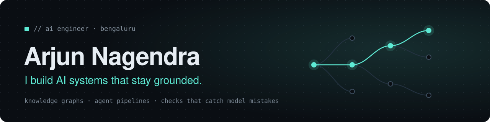

  

I'm **Arjun Nagendra**, an AI engineer. I design and build production LLM systems: pipelines grounded in knowledge graphs, long-running jobs that survive failure, and the validation layers that catch model mistakes. Right now that's AI for medical education at Orfiq.

That work lives in private repositories, so I keep a record of it at **[arjunn3.github.io](https://arjunn3.github.io/)**, with the problem, the decisions and an architecture diagram for each system.

### Selected systems

- **[Textbook generation pipeline](https://arjunn3.github.io/work/textbook-pipeline/)**: a three-stage LLM pipeline that drafts whole textbooks from a knowledge graph, with coverage checked by code, an independent reviewer model, and jobs that survive crashes.
- **[Graph-grounded case generation](https://arjunn3.github.io/work/grounded-case-generation/)**: fixed graph queries replace model-written ones, so everything a generated case cites is a real record.
- **[Reliability for long-running AI jobs](https://arjunn3.github.io/work/job-reliability/)**: clear errors, honest job status, safe cancellation, and fixes for multi-worker race conditions.
- **[Repairing malformed LLM output](https://arjunn3.github.io/work/document-repair/)**: deterministic repair of the rich-text JSON models get wrong, before it reaches the editor.
- **[Multi-provider image service](https://arjunn3.github.io/work/image-generation-service/)**: one service behind four product surfaces, with automatic failover between providers.

→ **[All work](https://arjunn3.github.io/work/)** · [What I'm working on now](https://arjunn3.github.io/now/)

### Stack

Python · FastAPI · PydanticAI · Neo4j · Cypher · Gemini · OpenAI · Azure · Pytest

### Elsewhere

[Website](https://arjunn3.github.io/) · [Email](mailto:arjunnagendra03@gmail.com)
